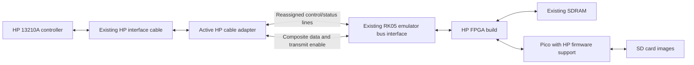

# HP 7900A / 13210A compatibility feasibility study

Date: 10 November 2026

The companion [development and diagnostic plan](HP7900A_Development_Plan.md) describes USB connections, debug hooks, capture, and hardware test stages.

The [drive-end adapter wiring](HP7900A_Adapter_Wiring.md) maps the original HP cable's single P3 connector to the emulator's existing connector signals and FPGA pins.

## Assessment

**Converting this emulator to replace an HP 7900A on an HP 13210A controller appears feasible. The recommended implementation is an HP-specific FPGA build, Pico firmware changes, and a small active adapter at the drive end of the HP cable.** The existing main PCB, FPGA, SDRAM, Pico, SD interface, and power supply should be reusable, subject to FPGA fitting and electrical validation.

A firmware/FPGA change with a passive connector adapter alone is not a credible complete solution: the HP cable carries read and write information on one bidirectional differential pair, whereas this board has separate single-ended write input and read clock/data outputs. FPGA configuration cannot change those external line drivers and receivers. Most command/status lines can probably use the existing interface circuitry after reassignment.

This is a document and source review, with a small timing simulation and address-map calculation. It is **not yet a demonstrated controller connection**, a finished adapter schematic, or a verified FPGA fit. The electrical adapter and the fit in the iCE40HX1K are the principal remaining feasibility checks.

## Evidence reviewed

The principal references are the two supplied manuals:

- [HP 7900A operating and service manual, October 1974](../Requirements/07900-90002_7900A_Disc_Drive_Operating_and_Service_Manual_Oct74.pdf), especially table 1-1; paragraphs 4-15, 4-19 through 4-21, 4-37 through 4-42, and 4-61 through 4-79; figures 5-26, 5-28, 5-30, 5-34, and 5-49.
- [HP 13210A interface manual, October 1974](../Requirements/13210-90003_Oct74_7900intf.pdf), especially section III, figures 4-1 and 4-2, operational flow diagrams, controller schematics, and table 5-4.

Repository evidence:

- [Main board schematic, v2 r03](../Schematics/RK05_Emulator-Tester_Main_Board_v2_r03.pdf), sheets 1, 2, 3, and 5.
- [Released FPGA source archive, v2.8](../Source_Code/FPGA_Emulator/Verilog_RK05_Emulator_v2-8.zip): `RK05_emulator_top_v05.v`, `drive_select.v`, `seek_to_cylinder.v`, `bus_outputs.v`, `timing_gen.v`, `sector_and_index.v`, `bus_disk_read.v`, `bus_disk_write.v`, `sdram_controller.v`, and the PCF pin assignments.
- [Experimental FPGA source, v2.12](../Source_Code/FPGA_Emulator/Experimental_Code/Emulator_Experiment_v2-12/Verilog_RK05_Emulator_Experiment_v2-12.zip), checked for relevant later changes. It retains the one-bit head selection and fixed write-decoder timing. Its read state machine includes changes for continuing across sector boundaries that merit review for HP operation.
- [Pico disk state](../Source_Code/Pico_SW_Emulator/RK05_Emulator_v02x07/disk_state_definitions.h), [hardware setup](../Source_Code/Pico_SW_Emulator/RK05_Emulator_v02x07/emulator_hardware.cpp), and [image loading/saving](../Source_Code/Pico_SW_Emulator/RK05_Emulator_v02x07/microsd_file_ops.cpp).
- [Controller-independent image format](Controller-Independent%20Emulator%20Data%20Format.pdf), particularly pages 1–7.

HP page numbers below are printed manual pages, with PDF page numbers where especially useful. Supplemental component checks used the [TI SN75107A receiver datasheet](https://www.ti.com/lit/ds/symlink/sn75107a.pdf) and [TI SN75451B documentation](https://www.ti.com/product/SN75451B). These support the electrical distinctions; they do not establish a completed substitute circuit.

## Similarities and differences that matter

The common cartridge family and recording method are helpful, but mechanical interchangeability does not imply electrical or recorded-format compatibility. In particular, the supplied HP specifications differ from the currently supported data rates.

| Property | Existing emulator implementation | HP requirement | Consequence |
| --- | --- | --- | --- |
| Cylinders | FPGA accepts 0–202 | 0–202 | Same range; HP seek/status behavior still differs. |
| Heads | One head-select bit, two surfaces | Four heads: two surfaces on each of removable and fixed discs | Widen internal head selection to two bits. |
| Sectors per track | FPGA supports up to 32 | 24 | Counter width is sufficient. |
| Serial bit rate | Pico recognizes 1.44, 1.545, and 1.6 Mbit/s | 2.5 Mbit/s; 400 ns bit cell | Add a rate setting and change write recovery timing. |
| Rotation | Programmable sector interval | 2,400 rpm; 25 ms/revolution | Approximately 1,041.667 microseconds/sector. |
| Sector pulse | 2 microseconds | Approximately 24 microseconds | Change pulse generation. |
| Read interface | Separate clock and data outputs | Composite clock/data on shared differential pair | Combine read pulses and add line conversion. |
| Write interface | Single-ended composite clock/data input | Same differential pair as reads | Add differential receiver and direction control. |
| Address/control | Cylinder bus, strobe, separate head/gate inputs | Multiplexed Outbus plus Set Cylinder, Set Head, Control | Add HP command decoding and address latches. |
| Rotational feedback | Sector number and index outputs | Drive performs sector comparison and returns Sector Compare | Add requested-sector register and comparator. |
| Status | RK05 signals and qualification | HP Inbus status, attention, ready signals | Implement HP status behavior. |

The HP drive specifications are in table 1-1, printed page 1-2 / PDF page 12. Sector pulse behavior is described in paragraph 4-42. The 13210A write-formatter bit-cell diagram is figure 4-2, printed page 4-3 / PDF page 19: nominal pulse width is **60 ns**, with a clock pulse every 400 ns and an additional pulse halfway through a cell containing a one. That establishes the incoming write waveform; the allowable emulator read-output pulse width must also be checked against the controller's receiver.

The complete drive has 203 × 4 × 24 = **19,488 sectors**, each carrying 128 sixteen-bit words, or **4,988,928 payload bytes**. Each platter accounts for 2,494,464 bytes. HP's rounded capacity specifications use 200 normal cylinders plus three additional cylinders; the emulator should retain all 203 addressable cylinders.

## Recommended hardware arrangement



The adapter would accept the HP cable where it would normally plug into the drive and connect to the emulator's existing bus connectors. HP's P3 table lists 48 contact positions; the existing Diablo adapters use a 42-contact interface, so a new connector adapter is needed. It need not have a processor or FPGA of its own. Its jobs are:

1. Route HP command and status signals to reassigned emulator signals.
2. Convert the shared differential data pair to a single-ended receive signal, and a single-ended transmit signal back to the pair.
3. Enable the differential transmitter only during a selected read operation; release it during writes, deselection, reset, and FPGA configuration.
4. Provide appropriate pull-ups, bias, termination, and power for that circuitry.

### Why the data pair needs active circuitry

The HP 7900A uses an SN75109 line driver and SN75107 receiver on the same pair; see the A10 parts list and figure 5-34, printed page 5-45 / PDF page 81. These are a different electrical interface from the emulator's SN75451-family open-collector outputs and 74LVC244 inputs, shown on schematic sheet 2.

Use an electrically compatible current-mode differential driver/receiver arrangement, or qualify a modern substitute against the original circuit. An arbitrary RS-422/RS-485 module is not an established replacement. The original receiver family uses positive and negative supplies and small differential thresholds; reproducing it literally would require an appropriate negative rail on the adapter. A modern implementation could change that requirement, after analysis of common-mode range, thresholds, loading, and disabled behavior.

HP termination is also distinctive. Figure 5-49, printed page 5-59 / PDF page 95, shows 316-ohm pull-ups with 750-ohm pull-downs for controller-to-drive logic lines, and 562-ohm pull-ups with 75-ohm pull-downs for the two data conductors. Those data networks are per conductor, not simply a 150-ohm resistor across the pair. Reconstruct the whole controller/cable/end-of-chain network before selecting final values. The DEC terminator is not an HP terminator.

The existing open-collector outputs appear suitable in principle for the relatively slow HP status signals. Their polarity and pull-ups must be checked against the populated driver variant: `bus_outputs.v` explicitly notes that inversion depends on which SN7545x device is installed. Treat all mappings below as signal allocation, not final polarity equations.

There is an additional speed check on the read path: narrow composite pulses must survive the board's output driver, adapter receiver/pull-up, differential transmitter, and HP cable while satisfying the controller receiver. If the existing open-collector stage distorts them excessively, regenerate pulse width on the adapter from a cleaner event signal, or take a direct FPGA signal to the adapter as a fallback. Either can preserve the main PCB, but the latter needs a short additional connection.

### There are enough existing signal paths

A possible allocation is below. Names identify existing board paths, whose RK05 functions would be replaced in the HP build. No additional FPGA pins are implied.

| HP or adapter signal | Existing emulator signal path | Direction relative to emulator |
| --- | --- | --- |
| Outbus 0–7 | `BUS_CYL_ADD_L[7:0]` | Input, eight lines |
| Select 1 and Select 2 | `BUS_SEL_DR_L[0]` and `[1]` | Input, two lines |
| Set Cylinder | `BUS_STROBE_L` | Input |
| Set Head and Sector | `BUS_HEAD_SELECT_L` | Input |
| Control | `BUS_RD_GATE_L` | Input |
| Differential receiver output | `BUS_WT_DATA_CLK_L` | Input |
| Inbus 0–4 | `BUS_SEC_CNTR_L[4:0]` | Output, five lines |
| Drive Ready | `BUS_FILE_READY_L` | Output |
| Access Ready | `BUS_RWS_RDY_L` | Output |
| Sector Pulse | `BUS_SEC_PLS_L` | Output |
| Sector Compare | `BUS_ADDRESS_ACCEPTED_L` | Output |
| Composite read pulse stream | `BUS_RD_DATA_L` | Output to adapter |
| Differential transmitter enable | `BUS_WT_CHK_L` | Output to adapter |

This uses **14 inputs and 11 outputs**, within the released top level's 20 bus inputs and existing driven outputs. The fifth sector-counter output exists on v2 hardware. FPGA read clock and read data pulses can be combined internally before driving the composite output; do not connect two physical outputs together.

HP cable connector numbers must be established separately from this logical allocation. The controller cable's P3, the drive's interface extenders, the internal XA16/XA17 connectors, and the terminator do not have interchangeable pin numbering. Use 13210A table 5-4 (printed page 5-11 / PDF page 42) together with the drive harness drawings. Confirm connector gender, keying, contact labels, shield, and grounds on the actual cable before producing the adapter PCB. Route emulator power deliberately; do not assume that an HP cable contact can supply it.

## FPGA work

### HP command and status interface

Replace the RK05 bus-facing logic with a small HP interface block. Most command/status functions require registers, gates, comparators, and timers; the HP controller continues to perform DMA, formatting, CRC generation/checking, and host command sequencing.

The block must distinguish the uses of the eight Outbus lines:

- Latch a cylinder address under Set Cylinder.
- Latch head and requested sector under Set Head. The five sector bits and two head bits share this bus.
- Under Control, decode write/read/erase requests on Outbus bits 0/1/2 respectively.
- Recognize the restore/home combination and the status/attention queries. Outbus bits 6 and 7 participate in attention/status gating; they are not always address bits.

Use the HP A7/A8 logic and controller waveforms to implement the qualification and latch edges. A direct renaming of RK05 read gate, write gate, or strobe would not reproduce these multiplexed functions.

HP output behavior includes:

| Function | Required behavior |
| --- | --- |
| Drive Ready | Reflect loaded/available media and drive fault state. |
| Access Ready | Indicate seek completion; maintain a meaningful busy interval on a seek. |
| Sector Compare | Compare the requested sector against the rotational sector counter and qualify the external output as HP does. |
| First Status | Set on becoming ready; clear at completion of a status-gate operation. |
| Seek Check | Set for cylinder >202, sector >23, or a seek issued while moving; clear on the next valid seek. |
| Data Protect | Reflect protection of the selected platter and inhibit modification. |
| Override | Report the formatting/protected-cylinder override setting. |
| Drive Unsafe | Report emulated fault state. |
| Attention | Latch completion and respond on the Inbus bit corresponding to the drive address when queried. |

Inbus 0–4 carry First Status, Seek Check, Data Protect, Override, and Drive Unsafe during a selected status query. Attention queries reuse the low Inbus lines for drive-specific attention. See drive paragraphs 4-61 through 4-69. **Attention must remain observable when another drive has been selected**; applying the existing `Selected_Ready` gate everywhere would lose this behavior. Status and completion latches also need to operate when normal data transfer is not enabled.

A single emulator should first represent one complete HP drive, address 0–3. Multiple emulated units in one FPGA are a separate extension. Test attention polling and release of shared outputs with other HP drives present before claiming mixed-chain support.

### Timing and data path

At 40 MHz there are **16 FPGA clocks per 400 ns bit cell**, or eight clocks per half cell. The existing read timing generator can produce this cell rate with divider settings 8/8. A temporary Icarus Verilog simulation of the released `timing_gen.v` confirmed 400 ns cell intervals and 75 ns pulse widths with settings 8/8/3.

That result establishes digital timing capability, **not acceptance of 75 ns pulses by the HP interface**. Its write reference waveform specifies 60 ns nominal. A 40 MHz clock gives a 25 ns pulse-width grid: two clocks give 50 ns and three give 75 ns. Establish the allowable read-output range experimentally/from receiver timing, or shape the pulse on the adapter. A separate faster timing clock derived from the existing oscillator is another option, subject to PLL, clock-domain, resource, and timing analysis.

The write data separator requires a real change. `bus_disk_write.v`, around lines 114–119, uses a fixed count of 27 and a fixed mid-cell detection window. These values belong to the slower existing interface. Adding `2500000` to the Pico's rate table would change read timing but would **not** fix write recovery. Rework or parameterize the separator for 400 ns cells, and verify capture of 60 ns pulses through the complete input path. Review the fixed write-gate startup delay too.

For rotation, use 24 sectors and approximately 1,041.667 microseconds per sector. Setting the current integer interval to 1,042 microseconds gives 25.008 ms per revolution, a 0.032% deviation from nominal. That is a reasonable prototype setting, subject to controller testing. A fractional counter can produce the exact average later. Change the sector pulse width from 2 to approximately 24 microseconds and implement HP sector numbering/compare timing. The RK05 external index output is not a substitute for Sector Compare.

The real drive has separate sector detection for the fixed and removable discs. A first emulator can use coincident virtual sector phases for both, provided all head selections address the right data and transitions satisfy controller timing. Mechanical skew need not be recreated for ordinary storage operation; diagnostic expectations should still be checked.

### Sector format is favorable

#### FM decoding, image representation, and regeneration

Both directions on the HP data pair carry FM clock/data pulses. The separate clock/data signals in the existing FPGA are internal ingredients for the composite output. The adapter performs electrical conversion; the FPGA performs FM decoding and encoding.

The recommended image remains the decoded sector bitstream already represented by `.rke`: record bits, including the address and CRCC, plus timing/length metadata. Decode incoming FM when the controller writes, and regenerate FM when the controller reads. This preserves controller-written record content without making the FPGA interpret or recalculate the CRCC.

| Decoded data bit | Pulse at cell boundary | Pulse at midpoint | Next cell boundary |
| --- | --- | --- | --- |
| 0 | Yes, at 0 ns | None | 400 ns |
| 1 | Yes, at 0 ns | Yes, at 200 ns | 400 ns |

The controller's illustrated pulse width is 60 ns. The decoder uses pulse position, rather than width, to distinguish a zero from a one. In the shorthand `0 -> 10`, `1 -> 11`, each channel bit means absence/presence of a pulse in a 200 ns slot. It does not mean holding the wire at a logic level for the whole slot. Playback still requires a pulse generator even if these channel bits are stored.

For incoming writes, synchronize the receiver output and detect pulse edges with a fast sampling clock. Acquire cell phase from the all-zero preamble, which provides clock pulses separated by 400 ns. Track those mandatory boundary pulses with a digital phase/period counter. A pulse in the midpoint window records a one; its absence records a zero. Keep boundary and midpoint windows distinct, and detect missing clocks or unexpected additional pulses. Re-establish phase on each write preamble. Free-running for an entire sector without tracking the controller clock, or treating every received pulse as a new cell boundary, is unsuitable.

The preferred target is a **100 MHz FM interface clock**, generated from the existing 40 MHz oscillator using the unused FPGA PLL, subject to place-and-route timing and resource checks. This gives 40 ticks per data cell, 20 per half cell, and six per nominal 60 ns pulse. At 40 MHz an input pulse spans only about 2.4 sample periods and output width is quantized to 25 ns. The faster clock provides useful capture and phase resolution and permits nominal 60 ns output pulses. The PLL generates the sampling clock; the digital counter recovers the incoming FM phase. See the [Lattice iCE40 PLL guide](https://www.latticesemi.com/view_document?document_id=47778).

Keep the SDRAM controller at its existing clock initially, transferring decoded words between clock domains using a proper handshake or small asynchronous FIFO. A sixteen-bit word arrives every 6.4 microseconds, so this crossing does not need a large buffer. The analogue path must still preserve the pulses: faster FPGA sampling cannot recover an edge that the receiver or board interface has removed.

For outgoing reads, fetch a decoded record bit, emit the mandatory clock pulse, and emit a midpoint pulse if the bit is one. Count from the sector reference to reproduce the stored preamble/sync position, and hold the transmitter enabled throughout the read operation, including the spaces between pulses. Check the final read pulse width at the controller end of the cable; the 60 ns write waveform alone does not establish its complete receiver tolerance.

Storing the expanded FM channel bits would roughly double bitstream storage and would still require input clock recovery, channel-pair alignment, and output pulse shaping. It could be useful for intentionally malformed clock patterns or more detailed media diagnostics. For ordinary HP storage emulation, decoded record bits with FM regenerated in the FPGA are the simpler fit to this repository. This recommendation has not yet been implemented or tested as an HP FM decoder.

13210A figure 4-1, printed page 4-2 / PDF page 18, shows this continuous sector layout:

| Field | Length |
| --- | --- |
| Zero preamble | 14 × 16 bits |
| Sync word | 16 bits, beginning with a one followed by zeros |
| Address word | 16 bits |
| User data | 128 × 16 bits |
| CRCC | 16 bits |
| Zero postamble | 16 bits |

The illustrated fields total **2,336 bits**, or 934.4 microseconds at 2.5 Mbit/s. This fits within the nominal sector interval. The existing `.rke` representation stores a delay to the first one, a bit count, and the subsequent bitstream. It can represent the remaining sync-word zeros, address, payload, and CRCC without interpreting them in the FPGA.

Normal HP Write Data rewrites the address field as well as the data field after its initial read/check step; Initialize Data writes the format without that preliminary check. Thus the supplied controller does not force a fundamentally incompatible separate-header update scheme. Preserve the actual gate timing and all received bits, including protection information in the address word.

Refine Sector is straddle erase without ordinary writing. The emulator should complete the operation without replacing the stored payload merely because erase was requested. The FPGA must distinguish write+erase from erase-only behavior.

## Memory and Pico firmware

### Capacity is sufficient; addressing must change

The main schematic shows a W9825G6KH-6 SDRAM with 24 word-address bits in the controller: 16M sixteen-bit words, or **32 MiB**. A convenient proposed HP layout reserves 32 sector slots per track, each 256 words / 512 bytes:

```text
SDRAM word address = (cylinder << 15) | (head << 13) | (sector << 8)
                    + word_offset_within_sector

cylinder: 0..202
head:     0..3
sector:   0..23
offset:   0..255
```

The reserved region occupies 203 × 4 × 32 × 512 = **13,303,808 bytes (12.6875 MiB)**. A sector slot can hold the two metadata words and the HP bitstream, including normal postamble capture. Bounds must prevent an abnormal gate interval from spilling into the next sector.

An exhaustive calculation over all 19,488 legal sector addresses found no overlap with this mapping; the highest occupied word, including slot padding, is `0x6577ff`, within the existing address range. This is a proposed allocation, not an implemented FPGA change.

There is a concrete existing firmware limitation to fix. In `microsd_file_ops.cpp`, both the load and save paths, around lines 334 and 392, use:

```cpp
ramaddress = (cylindercount << 14) | (headcount << 13) | (sectorcount << 9);
```

For HP geometry, sector 16 overlaps head 1, and head 2 overlaps the next cylinder. Applying that expression to all HP sectors gives only 6,528 distinct base addresses for 19,488 sectors. In addition, the FPGA already changes sector-slot spacing for tracks above 16 sectors, while these Pico paths retain fixed spacing. **Do not enable a four-head/24-sector image by changing only its header.** Both paths must use one agreed layout, and both must be validated on unload/reload.

### Firmware changes

1. Add the 2.5 Mbit/s setting and any new HP interface/status configuration registers.
2. Widen FPGA head selection and update SDRAM address construction; update Pico load/save addressing to match.
3. Validate the HP geometry and per-sector lengths before accepting an image. The generic header already contains cylinder, head, sector, and rate fields.
4. Supply HP Data Protect and Override settings. The existing write-protect switch can initially protect both platters; independent platter protection needs separate stored settings or a suitable configuration control.
5. Define media handling for the fixed disc and removable cartridge. One combined four-head `.rke` file is the simplest first version. Separate fixed/removable images would let the fixed disc persist while cartridges are exchanged and would be a useful later improvement.
6. Add an HP image creation/import/export utility. Reuse the `.rke` container, but implement HP address encoding, serial bit order, CRCC, and image word/sector ordering explicitly. The existing RK11 utility is not an HP converter.

The first write/read demonstration can use an image initialized by the actual HP controller. That lets the controller generate the correct address and CRCC bits, which the emulator records and replays. Importing an existing operating-system image requires a verified converter or a correctly formatted source image; a raw payload file alone lacks the recorded address/CRCC fields.

The Pico remains responsible for loading and saving images and configuration. Keep real-time controller handshakes and serial data in the FPGA. Preserve the existing persistence model unless deliberately extended: host writes update SDRAM, and unloading saves to SD. More capacity does not automatically provide continuous SD write-back.

## Alternatives

| Approach | Assessment |
| --- | --- |
| FPGA/Pico changes plus passive cable wiring | Insufficient for the HP differential data pair. |
| **HP FPGA/Pico changes plus active electrical adapter** | **Recommended.** Best reuse of the main board; modest external circuitry; HP protocol stays in the existing FPGA. |
| Active bridge translating HP into an unchanged RK05 emulator | Much more involved. It must reconcile different rates, four heads, command/status semantics, and geometry, with buffering. The bridge becomes another substantial controller. |
| HP interface daughterboard using direct FPGA connections | Fallback if the existing connector data path cannot preserve narrow pulses. More wiring, but the storage system can still be retained. |
| New emulator main PCB | No present evidence requires this. Reconsider only if fit or electrical measurements defeat the simpler options. |

A separate HP bitstream is preferable for the first prototype: replace RK05-specific blocks while retaining the memory/SPI infrastructure. Supporting both personalities simultaneously would consume more of the small FPGA and is not necessary to prove this conversion.

## Work sequence and acceptance criteria

| Stage | Concrete result | Acceptance criterion |
| --- | --- | --- |
| 1. Electrical prototype and pin audit | HP connector breakout, compatible data transceiver, selected existing I/O paths | Correct bias/loading and direction release; narrow pulses reach both receivers through the actual cable. |
| 2. HP interface RTL and synthesis | Drive selection, address latches, statuses, seek timing, sector comparison, revised address map | Fit in HX1K with timing met; simulation covers invalid addresses, busy seeks, attention polling, deselection, and reset. |
| 3. Read-only controller test | Preformatted known-pattern media on all four heads | 13210A reads correct addresses/payloads and checks CRCC across sector/head transitions. |
| 4. Writing and formatting | Revised write separator, Initialize, normal Write, Check Data, Refine behavior | Controller diagnostics pass write/read/check on all heads; protect/override rules behave correctly. |
| 5. Persistence and system use | HP image handling and SD save/reload | Distinct patterns across all 19,488 sectors survive unload, reload, and readback; operating-system boot succeeds. |
| 6. Mixed-drive validation | Emulator with other units on the HP cable | No shared-bus contention; attention and seek completion remain correct when selection changes. |

First test addresses should include cylinders 0 and 202, all heads, and sectors 0, 15, 16, and 23. Those cross the current address-map boundaries and expose aliasing quickly. Follow with a full address-derived pattern test, continuous multi-sector transfers, short transfers padded by the controller, and power/reset/media transitions. HP's cartridge-disc diagnostic is the appropriate final controller-level check; any tests requiring mechanical measurements need separate interpretation.

Outstanding decisions/checks are the exact installed 13210A PCA revisions and cable, final differential circuit and power rails, pulse-width tolerance through the existing board, HX1K resource/timing reports, and HP image conversion details. No full HP RTL has been synthesized, and no hardware or controller diagnostic was run during this study.

**Recommendation: proceed with an active cable adapter and a dedicated HP FPGA/Pico implementation.** The protocol, capacity, and timing review support that route. Expect substantive interface and write-decoder work, but the evidence does not suggest that the emulator's main hardware needs replacing.
