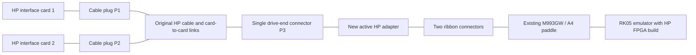

# HP 7900A adapter wiring using the original HP cable

Date: 10 November 2026

**Use the original HP double-ended controller plug and cable unchanged. Connect its single drive-end connector, P3, to the new active adapter.** The adapter connects to the RK05 emulator bus, preferably through an existing M993GW/A4 paddle and its two 40-pin ribbon connectors for the mockup.



The HP cable retains all controller-card interconnections. P1/P2 contacts in the tables below are tracing references, not instructions to modify those plugs. The emulator-side assignments are proposed allocations for the HP FPGA build, consistent with the earlier feasibility study. They do not describe the behavior of the stock RK05 bitstream.

## Connector names and source references

- **HP P1:** cable plug on Disc Interface 1, part 13210-60004 in the supplied October 1974 manual.
- **HP P2:** cable plug on Disc Interface 2, part 13210-60000.
- **HP P3:** the single drive-end plug of cable 13210-60003. This is the adapter's HP connection.
- **RK J1/J2:** the two 40-pin ribbon headers on the M993GW/A4 paddle, as named in its schematic. These are unrelated to the HP card connectors called J1.
- **A-K1, B-H1, etc.:** emulator bus contact names: A/B identifies the two portions of the paddle; the following name is its contact label. For example, A-K1 corresponds to main-board JA7/JA8 contact K1, and B-H1 to JB7/JB8 contact H1. The two main-board bus slots are electrically equivalent.
- **FPGA pin:** U1 iCE40HX1K TQ144 package pin, verified against the released PCF.

The controller schematics also use **P1 for the computer backplane connector**. HP P1/P2 in this document always mean the cable plugs in table 5-4, which mate with the cards' J1 connectors, not the computer backplane.

Sources checked:

1. [Supplied HP 13210A manual](../Requirements/13210-90003_Oct74_7900intf.pdf): table 5-4, printed page 5-11 / PDF page 42; Interface 1 schematic, PDF pages 34–35; Interface 2 schematic, PDF pages 38–41.
2. [M993GW v3 schematic](../Schematics/RK05_Adapter_Board_M993GW_v3.pdf): signal-to-ribbon and paddle contact assignments.
3. [Main board v2 r03 schematic](../Schematics/RK05_Emulator-Tester_Main_Board_v2_r03.pdf): sheets 1, 2, and 5, including the fifth sector-counter output.
4. [Released FPGA archive](../Source_Code/FPGA_Emulator/Verilog_RK05_Emulator_v2-8.zip): `iCE_em_v2-8/RK05_Emulator_v2-8.pcf`.
5. [Emulator setup instructions](../Setting%20up%20the%20emulator.pdf): either bus slot accepts the A4 paddle; component side faces up. Use the actual connector key/contact markings to establish the mating view.

A machine-readable version of the signal allocation is [HP7900A_Adapter_Pin_Map.csv](HP7900A_Adapter_Pin_Map.csv). The original connector pin assignments and the proposed reassignment are distinct: HP P3 and existing RK/FPGA pin locations come from the documents; their connection to one another is the new design proposed here.

## Controller to emulator: direct logic signals

These thirteen signals connect from P3 to the existing emulator input paths. Provide the appropriate HP end-of-line termination on the adapter. They do not need differential transceivers.

| HP signal | HP cable P1 | HP cable P2 | **HP P3** | Emulator contact | **RK ribbon** | Existing FPGA port | U1 pin |
| --- | --- | --- | --- | --- | --- | --- | --- |
| Outbus 0 | 18 | V | **2** | A-K1 | **J2-20** | `BUS_CYL_ADD_L[0]` | 136 |
| Outbus 1 | 19 | W | **A** | A-D1 | **J2-4** | `BUS_CYL_ADD_L[1]` | 122 |
| Outbus 2 | 20 | X | **S** | A-L1 | **J2-24** | `BUS_CYL_ADD_L[2]` | 137 |
| Outbus 3 | 21 | Y | **3** | A-C1 | **J2-2** | `BUS_CYL_ADD_L[3]` | 121 |
| Outbus 4 | — | 18 | **H** | A-F1 | **J2-8** | `BUS_CYL_ADD_L[4]` | 129 |
| Outbus 5 | 22 | Z | **J** | A-J1 | **J2-16** | `BUS_CYL_ADD_L[5]` | 135 |
| Outbus 6 | 23 | AA | **K** | A-E1 | **J2-6** | `BUS_CYL_ADD_L[6]` | 128 |
| Outbus 7 | 24 | BB | **D** | A-H1 | **J2-12** | `BUS_CYL_ADD_L[7]` | 134 |
| Select 1 / DS0 | T | — | **F** | A-J2 | **J2-18** | `BUS_SEL_DR_L[0]` | 101 |
| Select 2 / DS1 | S | — | **E** | A-K2 | **J2-22** | `BUS_SEL_DR_L[1]` | 102 |
| Set Cylinder | — | 19 | **C** | B-H1 | **J1-5** | `BUS_STROBE_L` | 88 |
| Set Head and Sector | — | 17 | **B** | B-M2 | **J1-21** | `BUS_HEAD_SELECT_L` | 93 |
| Control | 13 | P | **1** | B-R1 | **J1-31** | `BUS_RD_GATE_L` | 90 |

Where both P1 and P2 are listed, the original cable already connects both contacts to the same P3 net. These are multiplexed/shared controller nets, not two extra adapter inputs. The FPGA receives only the one signal at P3. HP head and sector selection is latched from Outbus; no separate additional head-address wire is required.

The intended HP aliases are `HP_OUTBUS_N[7:0]`, `HP_SELECT_N[1:0]`, `HP_SET_CYLINDER_N`, `HP_SET_HEAD_N`, and `HP_CONTROL_N`. Existing FPGA port names can remain for the pin constraints while the HP RTL uses those aliases internally. Preserve HP active-low logic through the non-inverting input buffers.

## Emulator to controller: direct logic signals

These nine signals use existing bus output drivers. Each Inbus line carries status or attention according to the HP query; it is no longer a sector-counter output in the HP build.

| HP signal | HP cable P1 | **HP P3** | Emulator contact | **RK ribbon** | Existing FPGA port | U1 pin |
| --- | --- | --- | --- | --- | --- | --- |
| Inbus 0 | 4 | **V** | B-L1 | **J1-15** | `BUS_SEC_CNTR_L[0]` | 79 |
| Inbus 1 | 5 | **W** | A-P2 | **J2-32** | `BUS_SEC_CNTR_L[1]` | 52 |
| Inbus 2 | H | **T** | B-K2 | **J1-13** | `BUS_SEC_CNTR_L[2]` | 63 |
| Inbus 3 | 8 | **U** | B-J1 | **J1-9** | `BUS_SEC_CNTR_L[3]` | 81 |
| Inbus 4 | 10 | **R** | A-B1 | **J2-1** | `BUS_SEC_CNTR_L[4]` | 73 |
| Drive Ready | M | **X** | B-N1 | **J1-23** | `BUS_FILE_READY_L` | 62 |
| Access Ready | N | **P** | A-H2 | **J2-14** | `BUS_RWS_RDY_L` | 107 |
| Sector Pulse | V | **M** | B-N2 | **J1-25** | `BUS_SEC_PLS_L` | 64 |
| Sector Compare | U | **N** | A-R2 | **J2-34** | `BUS_ADDRESS_ACCEPTED_L` | 106 |

The intended aliases are `HP_INBUS_N[4:0]`, `HP_DRIVE_READY_N`, `HP_ACCESS_READY_N`, `HP_SECTOR_PULSE_N`, and `HP_SECTOR_COMPARE_N`.

For the SN75451 devices shown in the schematic, tied logic inputs give a low bus output when the FPGA output is low; a high FPGA output releases it. Other SN7545x variants can change this relationship, as the source comments acknowledge. Confirm the populated driver family before fixing the HP output equations. The HP controller already has receiving-end bias/termination on these lines; account for that rather than indiscriminately adding another full terminator.

**Inbus 4 uses RK J2 pin 1.** RK J1 pin 2 is a different net, the tester's fifth-sector input. They must not be confused.

## Bidirectional FM pair and adapter logic

Keep the HP pair names **Data 1** and **Data 2** until the differential circuit's polarity is established; the cable table alone does not define a modern transceiver's A/B or +/− convention.

| HP data conductor | Origin on HP interface 2 | **HP P3** | Adapter connection |
| --- | --- | --- | --- |
| Data 1 | P2-21 | **Y** | One conductor of both differential receiver input and differential sender output |
| Data 2 | P2-20 | **Z and 22** | Other conductor of both differential receiver input and differential sender output |

**P3-22 is tied to P3-Z in the HP cable; it is not ground.** Maintain that net and verify continuity. These contacts go only to the compatible differential front end, never directly to RK logic inputs or outputs.

The adapter's three single-ended logic connections are:

| Adapter function | Emulator contact | **RK ribbon** | Existing FPGA port | U1 pin | Proposed HP alias |
| --- | --- | --- | --- | --- | --- |
| Receiver output to emulator | A-F2 | **J2-10** | `BUS_WT_DATA_CLK_L` | 99 | `HP_FM_RX_N` |
| Sender pulse input from emulator | B-S2 | **J1-37** | `BUS_RD_DATA_L` | 58 | `HP_FM_TX_N` |
| Sender enable from emulator | B-K1 | **J1-11** | `BUS_WT_CHK_L` | 80 | `HP_TX_ENABLE_N` |

```text
HP P3-Y  ----+---- receiver input 1
            +---- sender output 1

HP P3-Z  ---+---- receiver input 2
HP P3-22 ---+---- sender output 2

receiver logic output ---------- RK J2-10 ---> FPGA pin 99
sender logic pulse input <------ RK J1-37 <--- FPGA pin 58
sender enable interface <------- RK J1-11 <--- FPGA pin 80
```

This is a connection diagram, not a complete transceiver schematic. Use an HP-compatible current-mode differential interface, with the bias, termination, supply rails, and polarity described in the feasibility study. Translate the proposed low-active sender enable to whatever enable polarity the selected driver needs. Include suitable pull-ups on the single-ended open-collector output paths and ensure the sender defaults disabled during power-up/configuration/reset. Qualify it with the HP selected/read state; hold it enabled throughout a read operation, including the gaps between FM pulses. It must release for writes or deselection. The receiver may remain enabled, with its read echo ignored by the FPGA.

## Every P3 contact, including returns and unused positions

The following transcription is from the supplied cable table. It uses contact labels, not an assumed front-view drawing.

| Numeric contact | Function | Lettered contact | Function |
| --- | --- | --- | --- |
| 1 | Control | A | Outbus 1 |
| 2 | Outbus 0 | B | Set Head and Sector |
| 3 | Outbus 3 | C | Set Cylinder |
| 4 | Common | D | Outbus 7 |
| 5 | Common | E | Select 2 / DS1 |
| 6 | Common | F | Select 1 / DS0 |
| 7 | Common | H | Outbus 4 |
| 8 | Common | J | Outbus 5 |
| 9 | Common | K | Outbus 6 |
| 10 | Common | L | Not connected |
| 11 | Common | M | Sector Pulse |
| 12 | Common | N | Sector Compare |
| 13 | Common | P | Access Ready |
| 14 | Common | R | Inbus 4 |
| 15 | Common | S | Outbus 2 |
| 16 | Common | T | Inbus 2 |
| 17 | Common | U | Inbus 3 |
| 18 | Common | V | Inbus 0 |
| 19 | Common | W | Inbus 1 |
| 20 | Common | X | Drive Ready |
| 21 | Common | Y | Data 1 |
| 22 | Data 2, tied to Z | Z | Data 2, tied to 22 |
| 23 | Not connected | AA | Not connected |
| 24 | Shield | BB | Shield |

Connect **P3 contacts 4–21** to adapter signal ground and emulator signal ground. Use the available return contacts to keep the signal paths short. Preserve the cable's shield connection at **24/BB** and determine the appropriate enclosure/chassis bond on the mockup; keep shield and signal-common labels distinct in the drawing.

At the M993GW headers, ground is available at **RK J1 even pins 4–38** and **RK J2 odd pins 3–39**. RK J2-1 is Inbus 4 in this design, and RK J1-2 is the separate tester input: neither is a ground contact. The two 40-pin headers provide no adapter power supply. Power the active adapter from a defined local supply with a common signal-ground return; do not obtain power from a guessed HP contact.

Leave unused RK signal contacts unwired on the adapter, with the HP FPGA build ignoring those inputs. Do not add the DEC M930 terminator by default: the HP input termination and the short single-ended adapter paths need a deliberate termination arrangement, rather than an additional unexamined DEC load.

## Source discrepancies and mockup verification

The October 1974 table lists P1-J as connected to P3-U, while its P3-U row lists only P1-8. The controller schematic identifies Inbus 3 at Interface 1 J1-8. The proposed adapter uses the unambiguous **P3-U Inbus 3** net and does not require changing P1-J. Record actual cable continuity if this comes up during diagnosis; retaining the real cable avoids having to resolve that discrepancy to construct a new controller-side harness.

The HP controller drawings' references to the original drive's internal A17J1 contacts are a different numbering context from cable P3. Use P3 labels at the actual mating connector. Likewise, RK ribbon pin numbers above are those of the M993GW **v3** headers, not the Berg letter labels or the tester A6 adapter, whose wiring differs.

Before applying power, continuity-check the P3-to-RK wiring against these tables, establish the actual connector mating view, verify the data-pair duplicate contact, and check for signal-to-ground shorts. Identify the M993GW header pin-1 markings; J1 mostly carries signals on odd pins, while J2 mostly carries them on even pins. Then use an input/output test bitstream to verify each assigned path and the sender-disabled state before enabling normal HP operation. This pin allocation has been checked against the documents and PCF, but has not been electrically tested on the mockup.
