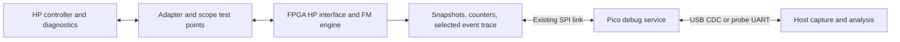

# HP 7900A development and diagnostic setup

Date: 10 November 2026

This plan turns the [compatibility study](HP7900A_13210_Feasibility_Study.md) into a repeatable development loop: build a version, load the emulator, run an HP diagnostic, capture the result, and change one relevant behavior. The hardware adapter and HP computer will supply the physical test environment; the emulator will expose enough internal state to explain failures.

The hardware arrangement uses the existing HP double plug/cable intact, with the adapter at its single drive-end P3 connector. See the [adapter wiring and FPGA pin map](HP7900A_Adapter_Wiring.md).

No HP firmware, FPGA instrumentation, flashing scripts, or hardware tests have been implemented by this document.

## Host connections

| Connection | Purpose | Implementation detail |
| --- | --- | --- |
| Host USB → Pico Debug Probe → Pico SWD | Load firmware, inspect RAM/registers, use breakpoints during idle tests | Use OpenOCD/GDB with an ELF containing debug information. |
| Host USB → probe UART bridge → emulator debug UART | Initial console, startup messages, and recovery channel | The current main program initializes UART0 on GP0/GP1 at 460800 baud. Use the existing board debug connection and verify its wiring. |
| Host USB → Pico native USB | Main command interface, structured logs, trace downloads | Enable USB CDC in the HP firmware; it is not currently explicitly enabled in CMake. |
| Host USB → Lattice download cable → J1 | Update FPGA configuration | This board's documented route programs external SPI flash. The cable is not a run-time FPGA debugger. |
| Host USB → HP console interface, optional | Load/select diagnostics, collect output, automate runs | Use the correct existing console interface for the HP machine. Without this connection, the operator starts tests and supplies diagnostic output. |
| Oscilloscope → adapter test points | Inspect differential amplitude, pulse shape, ringing, and turn-around | Internal FPGA traces and USB logs cannot establish analogue signal integrity. |

The [Raspberry Pi Debug Probe documentation](https://www.raspberrypi.com/documentation/microcontrollers/debug-probe.html) describes both SWD and the UART bridge. The [Pico SDK USB stdio documentation](https://www.raspberrypi.com/documentation/pico-sdk/runtime.html#group_pico_stdio_usb) covers USB CDC console support.

### Check permanent attachment before relying on unattended updates

The existing [Pico programming instructions](../_binary_images/RPi_Pico/_Raspberry%20Pi%20Pico%20Programming.pdf) remove the Pico from the board before connecting USB and explicitly disconnect USB before reinserting it. Inspect the actual board's VBUS/external-5-V wiring before using native USB while installed and powered. The probe's UART bridge provides a console while that is resolved.

The existing [FPGA programming instructions](../_binary_images/FPGA/_RK05%20Emulator%20FPGA%20Programming.pdf) disconnect the programming cable and cycle power after an update. Verify that the actual cable releases reset/configuration signals when idle, or provide a way to isolate them. Use reprogrammable SPI flash; keep one-time NVCM programming outside the development workflow.

Record the USB device identities, serial ports, programmer model, board revision, adapter wiring revision, and 13210A PCA revisions when the hardware is available. Exact programmer command-line support and host drivers must be established with the actual cable before promising fully automatic flashing.

## Debug architecture

Capture timing-sensitive events in the FPGA. Transfer completed records to the Pico over the existing SPI link, then drain them to the host. The existing `CMD_INTERRUPT` connection can notify the Pico that a capture is available. It should announce buffered work, rather than generate an interrupt for every FM pulse.

The FPGA must continue serving the controller while logs are collected. A disconnected USB terminal or slow host must not block read/write operation. Logging should use bounded queues with an explicit lost-record count. Keep the first error snapshot even if later records overflow. Reading a status register must not clear the evidence unless the host requests it.

The current firmware has a GPIO callback that reads FPGA state and calls `printf` for seek/read/write events. For HP development, replace that with short interrupt handling and buffered reporting from normal execution. USB support also needs review of the current character callback, which stores only one received character, before using it for reliable multi-byte host commands.

### Instrumentation to add first

| Hook | Information to capture | What it resolves |
| --- | --- | --- |
| Build identity | Firmware/FPGA versions, source revision, trace format, enabled debug profile | Confirms which implementation produced a result. |
| HP command snapshot | Select, Outbus, Control, Set Cylinder, Set Head, previous/current state | Incorrect command decoding, latch edges, or pin mapping. |
| Address state | Requested cylinder/head/sector, actual cylinder, rotational sector, SDRAM base | Wrong surface selection, sector compare, or address overlap. |
| Status state | Ready, Access Ready, Attention, First Status, Seek Check, Data Protect, Override, Unsafe | Diagnostic status failures and completion behavior. |
| FM acquisition | Write-gate timing, lock state, measured clock interval, midpoint observations | Failure to acquire clock/data phase. |
| FM interval statistics | Counts or histogram around 200/400 ns, minimum/maximum pulse width and phase error | Pulse capture, polarity, timing windows, and clock drift. |
| Record capture | Sync location, received bit count, selected decoded words, write completion reason | Incorrect preamble, sync, bit order, truncation, or word packing. |
| Transmit state | Sender enable, generated clock/data events, read bit count, underrun | Read failures and incorrect direction switching. |
| First error | Timestamp plus command/address/status/FM context, frozen until acknowledged | Preserves the initiating failure rather than only its consequences. |
| Storage state | Dirty state, image geometry, save/load outcome, address/length bounds errors | Distinguishes live emulation failures from persistence failures. |

These hooks are proposed internal observations, not additional HP-visible status bits. In particular, an internal trace error or underrun should not be assigned an HP status meaning without checking the drive behavior.

### Keep traces small and selectable

The HX1K has limited logic resources; the released SPI source already contains comments about removing readback functions to fit. Start with a coherent snapshot and a few counters, then fit and measure before adding a trace recorder.

Use separate debug profiles if necessary:

- Protocol profile: command/status/address events with a short pre-trigger history.
- FM profile: a bounded capture of edge intervals, phase decisions, and sync acquisition for one selected transfer.
- Storage profile: selected sector contents and address-map checks.

The host should be able to arm a capture for a particular drive, cylinder, head, sector, operation, or error. Freezing a trace stops recording; it does not halt the disk interface. A hardware freeze/acknowledge or double-buffer scheme must keep multi-byte SPI snapshots coherent, including crossings between the FM clock domain and the SPI/core domain.

A high-level event record should contain an event sequence number, FPGA timestamp, event type, address, flags, and relevant value. Specify the timestamp clock rate, wrap behavior, field widths, and byte order in the versioned trace format. Short FM captures can instead store edge deltas in sampling-clock ticks. Compare traces by sequence and hardware time, rather than assuming that USB arrival time is the time of the event.

## Useful host commands

Design a small command interface with explicit responses and error codes. Suggested operations are:

| Proposed command | Result |
| --- | --- |
| `info` | Build identity, board/adapter configuration, geometry, debug capabilities |
| `status` | Coherent current snapshot |
| `counters read` / `counters clear` | Timing/error counts; explicit reset of accumulated evidence |
| `trace arm ...` | Set capture profile, filters, and trigger |
| `trace status` / `trace dump` / `trace clear` | Inspect, retrieve, or explicitly discard a capture |
| `sector inspect C H S` | Stored metadata and decoded record bits for a selected sector |
| `media status` / `media save` | Dirty/save state and controlled persistence |
| `config read` / `config set ...` | Report or change documented HP parameters |

Separate routine observations from commands that alter media, assert reset, or change interface behavior. Downloading a sector during an active transfer must either use properly arbitrated memory access or wait for idle: the current controller has a shared memory address pointer, so arbitrary debug reads could otherwise disrupt it.

Native USB must not be required for startup. Start emulation even when no terminal is connected. Prefer structured records and bounded output over continuous verbose printing. Keep configuration writes out of tight polling loops.

## Development stages

1. **Establish a reproducible baseline.** Put editable FPGA sources under version control with provenance from the released archive, pin the Pico SDK/tool versions, reproduce a known RK05 build, and retain recovery binaries. Identify the actual FPGA programmer and verify its CLI/driver path.
2. **Prove programming and observation.** Load firmware through SWD, verify UART/USB commands and build IDs, and establish the FPGA update/restart sequence. Confirm reset and transmitter-disable behavior with the attached tools.
3. **Exercise the adapter independently.** Use a test FPGA build to check each mapped input/output and the data receiver/transmitter with known pulses. Scope both ends of the electrical path, including the sender-disabled state.
4. **Run HP selection/status/seek diagnostics.** Add the minimal HP interface with snapshots first. Compare controller requests with emulator state and reported status before attempting data transfers.
5. **Prove read timing and encoding.** Supply a known formatted image. Check sector pulse/compare timing, all four heads, FM output, and correct record/CRCC acceptance by the controller.
6. **Prove incoming FM and writes.** Capture preamble acquisition, sync, bit count, and stored words during controller initialization and writing. Verify by subsequent HP reads/checks.
7. **Expand diagnostic coverage.** Include all heads, boundary sectors, invalid seeks, protection/override, attention polling, short and multi-sector transfers, and selection changes. Run the full address-derived pattern test.
8. **Verify persistence and system use.** Save/unload/reload, repeat readback, and boot an HP operating-system image. Repeat successful tests with routine tracing disabled to check for behavior dependent on instrumentation.

Use repeatable captures for every change. Each run should identify its test/diagnostic version and options, firmware and bitstream hashes, image hash before/after, configuration, HP console transcript, and emulator trace. Record whether a failure reproduced and the exact first failing address/operation. When the HP console is connected to the host, scripts can later start a selected diagnostic, arm emulator capture, and collect both transcripts into the same run directory.

## Adapter mockup provisions

Bring out labeled test points for the two differential conductors, single-ended receiver output, sender pulse input, sender enable, and local ground. Provide a convenient way to force the sender disabled while checking the wiring, and verify that it releases during FPGA programming/reset. A trigger point for the selected transfer or first-error capture will help correlate scope measurements with internal traces if the spare signal allocation permits it.

Resolve the fixed adapter pin assignment, supply arrangement, termination, and installed-board USB power arrangement before treating the mockup as a permanent attached development fixture. A repeatable programming/reset method and scope access will save more debugging time than a large initial set of software features.
